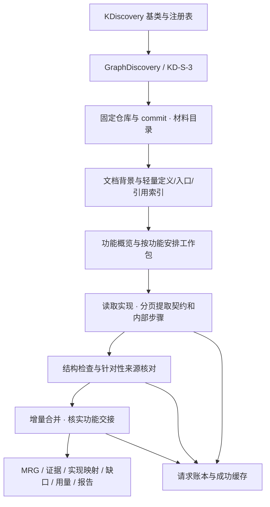
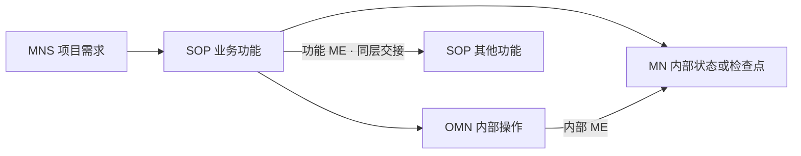

# 模块结构与契约

## 语义

包含线不代表执行顺序。SOP 输入/输出通过边界映射连接内部步骤端口。不存在来源支持的关系时不造边；空关系集合不能证明功能独立。

## 代码分层

| 层 | 入口 | 职责 |
|---|---|---|
| 公共 API | `KDiscovery`, `GraphDiscovery`, `initialize_workspace` | 注册、实例化、执行、初始化格式 |
| 执行 | `kd_s3.py`, `kd_s3_calls.py` | 工作包调度、预算、恢复和组装 |
| 索引 | `kd_s3_index.py`, `kd_s3_index_worker.py`, `runtime.py` | Tree-sitter 定义、直接引用、隔离解析与工具指纹 |
| 需求 | `kd_s3_requirements.py`, `kd_s3_contracts.py`, `kd_s3_branches.py` | 文档范围、契约、增量和分支归属 |
| 来源核对 | `kd_s3_review.py`, `kd_s3_support.py` | 字段来源、局部删除与合法内容保留 |
| 公共基础 | `kd_s2_*`, `kd_materials.py` | 材料、Schema、证据、功能交接合并与报告 |
| 适配 | `providers.py`, `github_client.py`, `api.py`, `cli.py` | 模型/GitHub 接口及显式 CLI |

业务正文以根目录 `mrg.format.json` 为定义；相同副本作为 wheel 资源随包安装。两者由离线测试保持一致。MRG 格式标识、策略规则、源码指纹与模型配置都应冻结到运行身份。

## 保持和改变

保留当前算法提示词、工作包排序、业务粒度、预算与部分成果保存机制。封装只调整运行环境：移除主应用耦合、从已安装的固定版本加载语法包、改为包内子进程导入、提供独立模型适配器。旧 Joern 执行器和 KD-S-2 策略类不随包发布，活动路径所需公共函数保留。封装修改单独形成指纹，不冒充历史实验原二进制。
