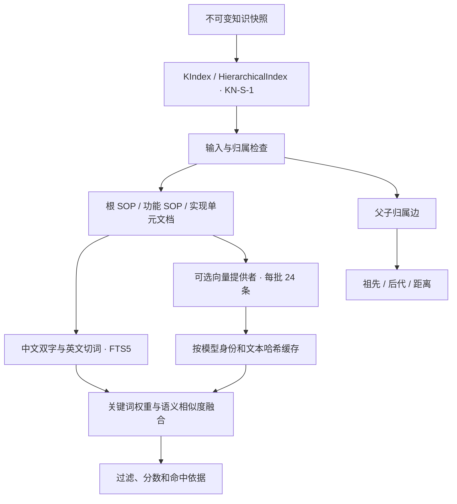

# 分层索引结构

| 模块 | 责任 |
|---|---|
| knowledge_strategies.py | KIndex 抽象类与策略注册 |
| kn_s1.py | 文档生成、构建、检索、层级回溯 |
| retrieval.py / knowledge.py / vector_index.py | 原实现中使用的纯函数；不引入 M2 或整个知识服务 |
| store.py | 小型 SQLite 事务与 Row 适配器 |
| contracts.py | 归属图检查；不推断业务能力 |
| providers.py | 默认关闭向量、可注入协议、显式远程适配 |
| cli.py | 构建/查询/回溯命令 |

存储表：`kn_nodes` 节点、`kn_edges` 包含关系、`kn_search` FTS5 文本、`kn_vectors` 快照向量成员、`kn_vector_cache` 跨快照内容缓存。独立包增加 `kn_snapshot_identity` 检查快照 ID 与完整数据的绑定，避免只更新非检索元数据时留住旧值。

关键词索引事务发布。向量缓存按成功批次保存，全部向量获取成功后才发布该次向量成员。首次构建向量失败时关键词成果可用；不同快照的成员互不覆盖。

库调用者应串行执行同一快照/模型的 build；SQLite 防止事务交叉写坏，但本包不提供跨进程模型调用去重或分布式调度。实时状态、服务告警和完整用量账本属于调用方。

只读查询保持原权重：FTS5 的名称/目标/场景/端口/标签权重为 6/4/2/2/1，关键词排名贡献为 `1/(20+rank)`，向量正余弦相似度贡献为 `0.04*similarity`。两者相加后排序。候选截取与过滤顺序沿用原实现，因此不能把结果数量不足当作全库没有更多匹配。
